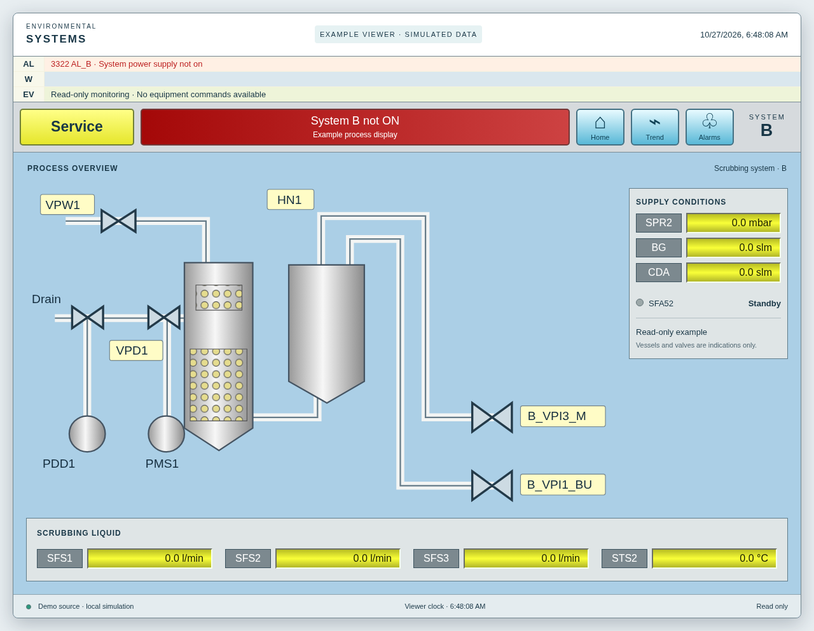
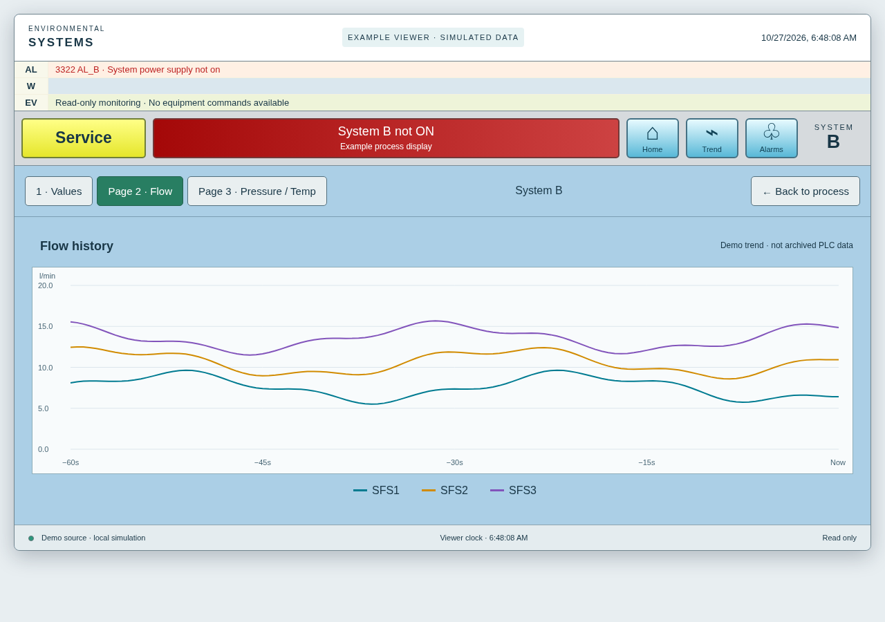

# Example web viewer

The C# application serves `src/Gateway/wwwroot/index.html` at `/`. Start it with:

```bash
dotnet run --project src/Gateway
```

Open `http://127.0.0.1:5080/` in your browser. No frontend build, npm packages, external fonts or CDN access are required.

The example follows the two supplied reference images: a System B scrubber overview, and a tabbed values screen reached through **Trend**. Page 1 contains gas MFC set/actual values, reactor pressure, scrubbing-liquid flows and temperatures, and unconfigured fresh-water flow. Page 2 adds an example flow chart. Page 3 adds example pressure and temperature charts. Only two reference images were available; the additional chart pages are illustrative rather than reproductions of missing reference images.

**This is a standalone demonstration, not a live PLC viewer.** Numeric indicators are initial zero placeholders and charts are generated illustrative curves. It does not fetch the acquisition APIs, subscribe to SignalR, read historical PLC records, acknowledge alarms or send equipment commands. Demo banners remain visible on every screen. The displayed alarm and standby state are example indications.

## Preview





## Files

- `wwwroot/index.html`: overview SVG and values/trend screens.
- `wwwroot/viewer.css`: industrial display styling and responsive layout.
- `wwwroot/viewer.js`: navigation, accessible tabs, local clock and Canvas chart rendering.
- `Program.cs`: serves default and static files after API-key middleware.

The existing API-key policy protects the viewer as well as APIs. If `GatewayApiKey` is configured, the browser's page and asset requests must carry `X-Api-Key` (for example, through a trusted authenticated reverse proxy). Direct navigation without the header returns 401; the example does not put a key into URLs or local storage. Default loopback-only startup without an API key works directly.

For frontend-only inspection, serve `src/Gateway/wwwroot` through any local static HTTP server. This does not start the .NET backend or its API-key middleware.

## Validation

Browser checks exercised overview → Trend → all three pages, chart drawing, arrow-key tab navigation, Back, Home and Alarms. Desktop and 390 px mobile layouts were checked for horizontal overflow, and no JavaScript runtime errors occurred. To repeat manually, follow these paths, resize the browser and confirm demo labels remain visible.

To connect real equipment later, configure an explicit site-specific mapping between the screen symbols and controller/tag IDs. Use `/api/latest` for current quality-aware values, `/api/trend/{controller}/{tag}` for committed archive buckets and `/live` for committed updates. Render Bad/Stale values as unavailable, preserve gaps and do not present these demonstration curves as real history. See `docs/api.md`.
